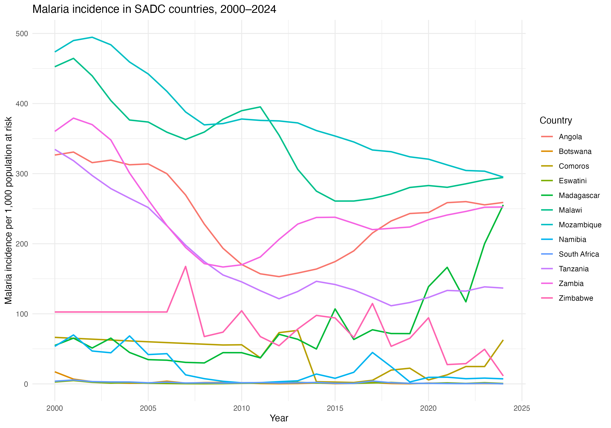
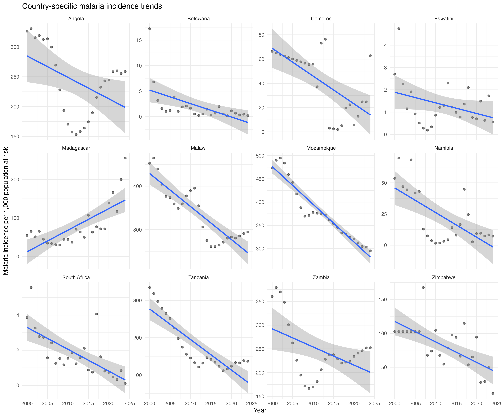
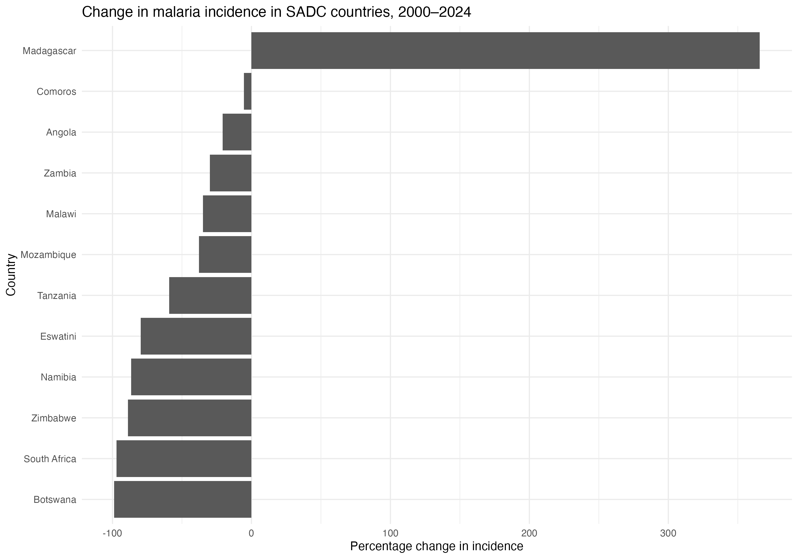
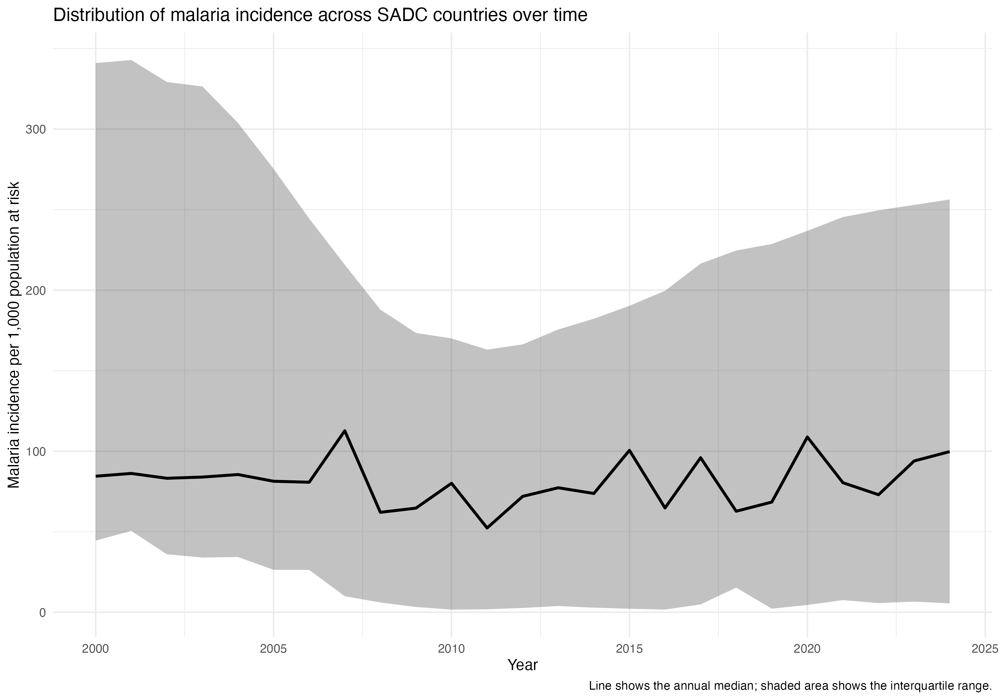
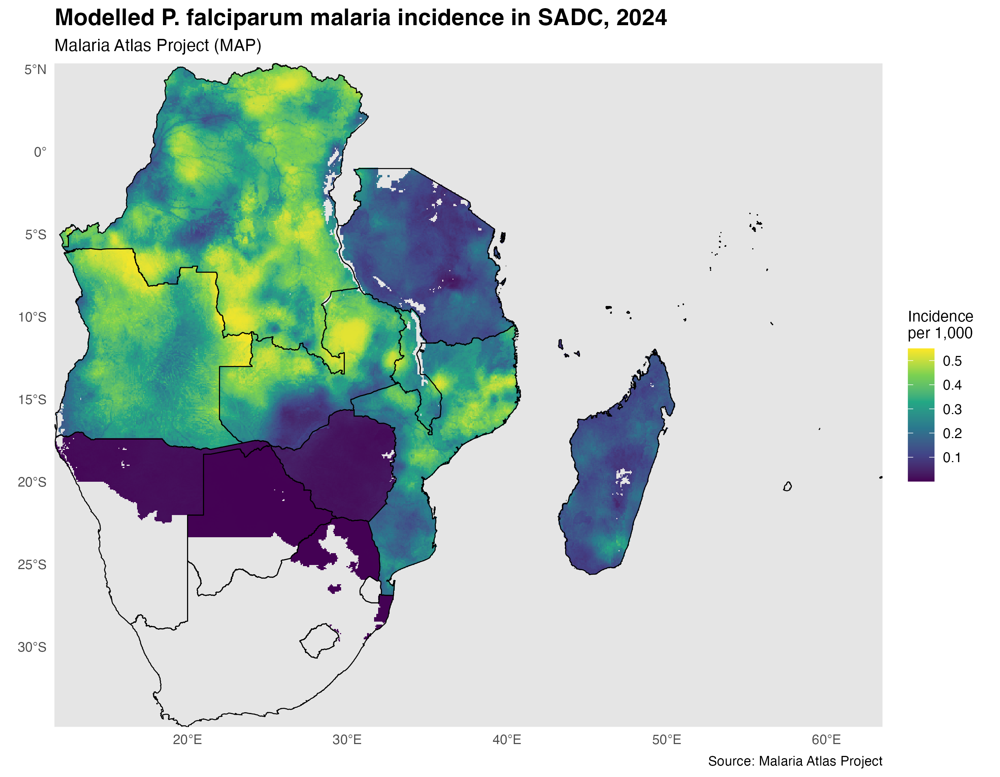
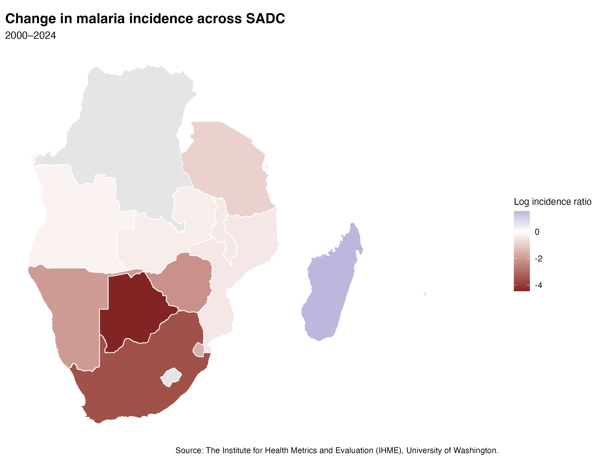

# SADC Malaria Incidence

## Overview

This project examines **malaria incidence trends and inequalities across SADC countries from 2000–2024** using epidemiological and statistical methods.
The analysis focused on how malaria burden has changed over time and how it varies geographically across countries.

## Research Question

> **How have malaria incidence trends and inequalities evolved across SADC countries from 2000–2024?**

## Study Area

The analysis includes 14 SADC countries:

Angola, Botswana, Comoros, Democratic Republic of Congo, Eswatini, Lesotho, Madagascar, Malawi, Mozambique, Namibia, South Africa, Tanzania, Zambia, and Zimbabwe.

Seychelles and Mauritius are missing from the dataset.

## Data

* Annual malaria incidence: **2000–2024**
* Outcome: **malaria incidence per 1,000 population at risk**
* Unit of analysis: **country-year**

A complementary spatial analysis uses the MAP malariaAtlas *P. falciparum* incidence-rate dataset for 2024.

The dataset can be accessed from the Institute for Health Metrics and Evaluation: https://ghdx.healthdata.org/ihme_data

## Key Methods

* Descriptive statistics
* Linear regression
* Mixed-effects models
* Generalized least squares
* AR(1) correlation
* Annual percentage change
* LOESS smoothing
* Spatial mapping

## Visualizations

<table>
<tr>
<td align="center">

 
<strong>Malaria incidence trends</strong>
</td>

<td align="center">

 
<strong>Country-specific trends</strong>
</td>

<td align="center">

 
<strong>Change, 2000–2024</strong>
</td>
</tr>

<tr>
<td align="center">

 
<strong>Between-country inequality</strong>
</td>

<td align="center">

 
<strong>2024 P. falciparum incidence</strong>
</td>

<td align="center">

 
<strong>Incidence change, 2000–2024</strong>
</td>
</tr>
</table>

## Reproducibility

The analysis is conducted in **R** and documented in an R Markdown file.

Main packages include:

`tidyverse` · `lme4` · `lmerTest` · `nlme` · `emmeans` · `malariaAtlas` · `sf` · `terra` · `tidyterra`

## Limitations

This is a **country-level epidemiological analysis**. The results describe population-level patterns and should not be interpreted as individual-level associations or causal effects.

## Author

**Careen Evans Joseph**
Master's Student in Epidemiology
Ludwig-Maximilians-Universität München (LMU)
